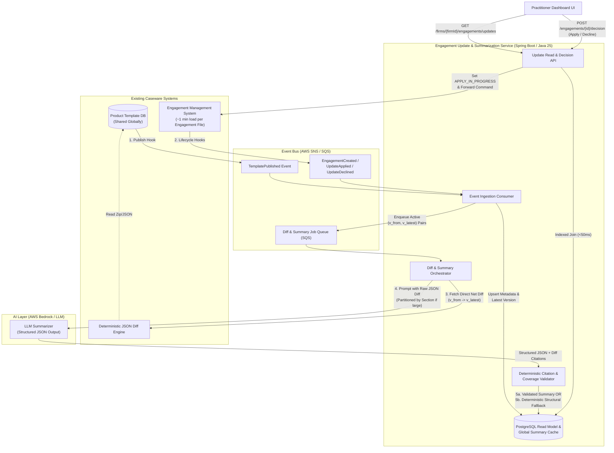
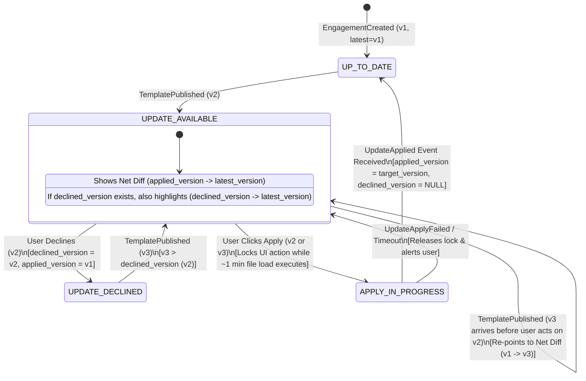

# Architecture Design: Engagement Template Update & Summarization System

## Executive Summary & Core Principles
Practitioners need an up-to-date, at-a-glance view of pending Product Template updates across hundreds of Engagement Files per firm, paired with a trustworthy, human-readable summary of changes to guide their **Apply** or **Decline** decision. 

This design addresses three primary constraints:
1. **Bypassing the ~1-minute Engagement File load constraint:** We introduce an event-driven CQRS Read Model in **PostgreSQL** to serve dashboard queries in < 50 ms without loading engagement files.
2. **Global Template Caching & Direct Net-Diffing:** Because Product Templates are shared across all firms, diffs and summaries are computed once per active `(template_id, v_from, v_to)` pair and cached globally. To prevent compounding LLM hallucinations and accurately reflect reverted changes across accumulated updates (e.g., v1 -> v2 -> v3), the system **never** summarizes prior text summaries; it always computes the deterministic JSON diff directly between `(applied_version, latest_version)`.
3. **Zero-Trust AI Guardrails in an Audit Domain:** LLM outputs are constrained to structured JSON citing exact paths from the deterministic diff. A post-processing validator verifies 100% section coverage before caching; on validation failure or timeout, the UI gracefully degrades to a human-formatted structural view of the deterministic diff headers.

---

## 1. High-Level Architecture

### 1.1 System Architecture Diagram

### 1.2 Data Model & Why PostgreSQL over DynamoDB
We use **Amazon RDS for PostgreSQL** for the Read Model and Summary Cache, containing three core tables:
* `product_template_latest`: `(template_id PK, latest_version, published_at)`
* `engagement_metadata`: `(engagement_id PK, firm_id, template_id, applied_version, declined_version, sync_status, updated_at, last_event_seq)` — indexed on `(firm_id, template_id)`.
* `template_diff_summary`: `(template_id, from_version, to_version, status, structural_diff_jsonb, ai_summary_jsonb, created_at)` — composite PK `(template_id, from_version, to_version)`.

**Why PostgreSQL:** When a new template version is published, PostgreSQL requires **a single row upsert** into `product_template_latest` (O(1) write) rather than fanning out writes to hundreds of thousands of engagement records in DynamoDB. When a practitioner opens their dashboard, a single indexed query joins the firm's ~100s of engagements with `product_template_latest` and `template_diff_summary`, returning all pending updates in a single round-trip.

### 1.3 State Machine: Accumulated Updates, Declines & Concurrency Lock
An engagement has a pending update whenever:
`latest_version > applied_version AND (declined_version IS NULL OR latest_version > declined_version)`

* **Accumulated Updates (v1 -> v2 -> v3):** Whether the user ignored v2 or explicitly declined v2, their engagement file remains on v1. When v3 is published, applying v3 transitions the engagement file directly from v1 to v3. Therefore, the primary summary displayed is always the **direct net diff** `(v1 -> v3)`. If the user previously declined v2, the API also attaches the `(v2 -> v3)` summary as a secondary *"New since you declined v2"* section so the auditor immediately sees why they are being prompted again.
* **Direct Net-Diff Rule (No Summary Chaining):** The orchestrator always invokes the JSON Diff Engine directly on `(v_applied, v_latest)`. If a field was added in v2 and reverted in v3, the net diff `(v1 -> v3)` cleanly omits it. If a cumulative diff is large, the orchestrator splits the deterministic JSON diff by **top-level template section/document** and summarizes each section independently in parallel—never by feeding prior LLM text outputs back into the LLM.

### 1.4 Deterministic Guardrails & Graceful Degradation
To ensure audit-grade traceability, the Summarization Pipeline enforces a two-layer contract:
1. **Deterministic Structural Header Extraction:** Before calling the LLM, the worker parses the raw JSON diff into a clean, deterministic structural summary (e.g., list of modified section titles, form names, and count of added/updated/removed attributes) and saves it to `structural_diff_jsonb` with `status = GENERATING_AI`.
2. **Constrained LLM Generation & Citation Validation:** The LLM is prompted with the raw JSON diff and required to adhere to a strict JSON schema where every bullet point must include `source_paths: string[]` referencing exact keys from the input diff. A deterministic Java validator checks:
   * **No Hallucinated Paths:** Every `source_path` cited by the LLM must exist in the input JSON diff.
   * **Complete Section Coverage:** Every modified top-level template section in the JSON diff must be represented in at least one summary item.
3. **Graceful Degradation:** If the LLM times out, hits rate limits, or fails validation after 1 retry, `status` is set to `FALLBACK_STRUCTURAL`. The UI immediately renders the deterministic `structural_diff_jsonb` view with a clear badge, ensuring practitioners are never blocked from evaluating or applying updates.

---

## 2. Implementation Plan

The rollout is structured into three incremental, parallelizable phases that deliver immediate practitioner value before AI tuning is even complete:

| Phase | Scope & Parallelizable Workstreams | Business Value Delivered |
| :--- | :--- | :--- |
| **Phase 1: Event Read Model & Deterministic Diff UI** | **Stream A:** Add event hooks (`TemplatePublished`, `EngagementCreated`, `UpdateApplied`, `UpdateDeclined`) to existing systems. **Stream B:** Provision PostgreSQL Read Model, SQS queues, and Spring Boot ingestion/read APIs with `APPLY_IN_PROGRESS` locking. **Stream C:** Integrate JSON Diff Engine to populate `structural_diff_jsonb` (section headers & change counts). | Practitioners get sub-50 ms "at-a-glance" update visibility across hundreds of engagements and a deterministic structural diff breakdown. |
| **Phase 2: Async LLM Summarization & Guardrails** | **Stream A:** Build async SQS worker to identify distinct active `(applied_version, latest_version)` pairs on template publish and invoke AWS Bedrock. **Stream B:** Implement the JSON Schema citation validator, section-level diff partitioning, and automatic fallback to Phase 1 structural view. | Non-technical practitioners receive plain-language audit summaries grounded in deterministic diff citations. |
| **Phase 3: Legacy Backfill & Operational Hardening** | **Stream A:** Backfill existing engagements into PostgreSQL (via a metadata export script if possible, or a throttled off-peak background loader + lazy read-through on engagement open). **Stream B:** Configure New Relic dashboards, alerts, and LLM evaluation pipelines. | Full production readiness across 100% of legacy and new engagements with end-to-end observability. |

---

## 3. Testing Strategy

1. **Unit & Domain State Machine Tests (JUnit 5):**
   * Verify all state transitions across accumulated updates (v1 -> v2 -> v3), declined version re-notification (`v3 > v_declined`), and idempotent handling of duplicate or out-of-order events (`event_seq_num` checks).
   * Verify the `Validator` rejects synthetic LLM outputs containing fabricated JSON paths or missing modified template sections.
2. **Contract & Multi-Tenant Integration Tests (Testcontainers):**
   * Spin up ephemeral PostgreSQL and LocalStack (SNS/SQS) containers to validate end-to-end event ingestion and concurrent `APPLY_IN_PROGRESS` locking (`SELECT ... FOR UPDATE` / optimistic locking).
   * **Tenant Isolation Verification:** Assert that Firm A's API context can never read or mutate Firm B's `engagement_metadata` rows, while safely sharing read-only `template_diff_summary` records.
3. **AI Quality & Regression Evaluation Suite:**
   * Maintain a **Golden Dataset** of historical Caseware Product Template JSON diffs (including edge cases: massive regulatory updates, reverted changes across v1 -> v3, and formatting-only changes).
   * Run automated evaluation in CI on prompt/model changes measuring: **Citation Precision** (100% deterministic requirement), **Section Recall** (100% deterministic requirement), and **Semantic Faithfulness** (graded by SME rubrics / LLM-as-a-judge).

---

## 4. Evaluation & Observability

Using **New Relic** and OpenTelemetry, we monitor both distributed system health and AI quality:

* **System SLIs & Operational Health:**
  * **Dashboard Read Latency:** Target p95 < 50 ms, p99 < 150 ms for listing ~500 engagements for a firm.
  * **Event Projection Lag:** Time from `TemplatePublished` or `UpdateApplied` emission to PostgreSQL projection update (Target p99 < 5 s).
  * **Queue Health:** SQS consumer lag and Dead Letter Queue (DLQ) depth > 0 page on-call.
  * **Stuck Lock Detection:** Alert and auto-expire if any engagement remains in `APPLY_IN_PROGRESS` for > 5 minutes (indicating the Engagement Management System failed silently during the ~1-minute load).
* **AI Quality & Cost Telemetry:**
  * **Guardrail Fallback Rate:** Percentage of LLM summaries rejected by the deterministic citation/coverage validator. A spike indicates prompt drift or unexpected template JSON schema changes.
  * **Summary Cache Hit Ratio:** Percentage of dashboard summary views served directly from `template_diff_summary` vs. triggering an on-demand job for an uncached long-tail version pair.
  * **Practitioner Decision Telemetry:** Track UI thumbs-up/down feedback on summaries and correlate summary views with time-to-decision (Apply vs. Decline).

---

## 5. Failure Modes & Tradeoffs

### 5.1 Failure Modes & Mitigations

| Failure Scenario | Impact | Mitigation Strategy |
| :--- | :--- | :--- |
| **LLM Hallucinates, Omits a Section, or Times Out** | Practitioner could be misled or blocked during an audit. | **Deterministic Validator + Fallback:** Output is rejected if any citation path is invalid or any modified section is omitted. UI immediately serves the deterministic `structural_diff_jsonb` (section titles & field counts) so the user is never blocked. |
| **User Opens Dashboard Seconds After `v_new` Publish** | LLM job is still running (`GENERATING_AI`). | UI immediately shows the "Update Available" badge using the relational join and renders `structural_diff_jsonb` with a *"Generating plain-language summary..."* indicator that updates on poll/push. |
| **Two Users Click "Apply" Simultaneously on Same File** | Triggers two expensive 1-minute file loads and potential write corruption. | Atomic conditional update (`UPDATE engagement_metadata SET sync_status = 'APPLY_IN_PROGRESS' WHERE engagement_id = ? AND sync_status != 'APPLY_IN_PROGRESS'`). Second request receives `409 Conflict`. |
| **Out-of-Order or Duplicate Events from EMS** | `EngagementCreated (v1)` arrives *after* `UpdateApplied (v2)`, regressing version state. | Events carry a monotonically increasing `event_timestamp` / `version_seq`. PostgreSQL upserts enforce `WHERE EXCLUDED.applied_version >= engagement_metadata.applied_version`. |
| **Long-Tail Version Gap (v1 -> v20) Exceeds Token Limit** | Raw net JSON diff is too large for a single LLM context window. | Orchestrator partitions the net `(v1 -> v20)` JSON diff deterministically by top-level template module/section, summarizes each section in parallel, and merges the validated JSON arrays. |

### 5.2 Key Architectural Tradeoffs
1. **Direct Net-Diff Generation vs. Chaining Stepwise Summaries:**
   * *Decision:* Always run the JSON diff engine on `(v_applied, v_latest)` and summarize that net diff rather than asking an LLM to combine the text of `Summary(v1 -> v2)` and `Summary(v2 -> v3)`.
   * *Tradeoff:* Requires O(K) LLM calls per weekly template publish (where K is the number of distinct active `applied_version` values across firms, typically K < 15), rather than O(1) call. Given updates occur only once per week per product, paying a few extra cents per week for K pre-computed net summaries is trivial compared to eliminating compounding LLM hallucinations and accurately cancelling out reverted changes.
2. **Pre-Computing Active Version Pairs vs. Pure On-Demand Generation:**
   * *Decision:* When `v_latest` is published, query `SELECT DISTINCT applied_version FROM engagement_metadata WHERE template_id = ?` and pre-compute net summaries for active versions asynchronously; use lazy on-demand generation with a cache-aside pattern only if an archived engagement on an ancient version is opened.
   * *Tradeoff:* Slightly higher background compute on publish day in exchange for near-100% cache hit rates and instant UI loads for practitioners.
